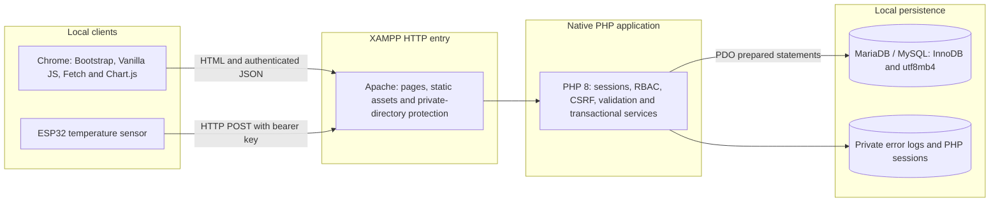
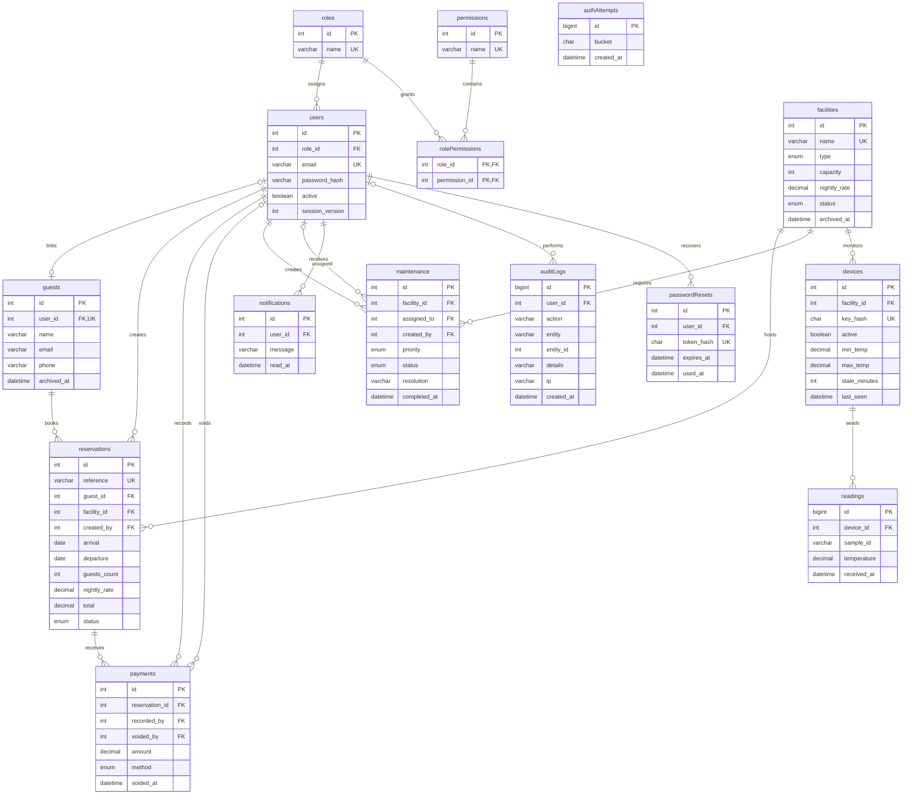
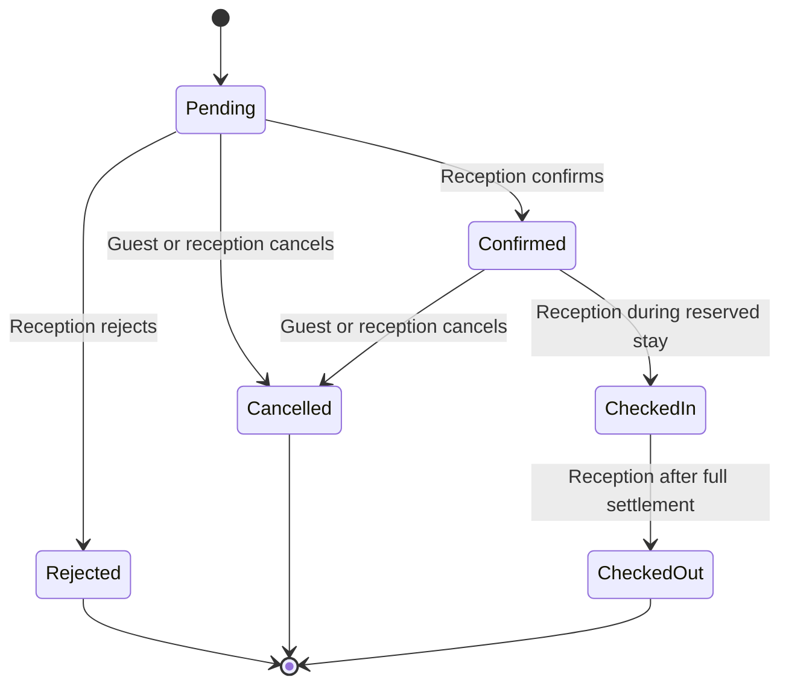

# Architecture and database design

## Local architecture

Anonymous requests to `index.php` render `views/landing.php`; authenticated requests render the protected workspace. `home.php` always renders the public landing page. `api/public.php` exposes only active, unarchived room/cottage descriptions, capacity, rates and validated date availability. It accepts GET only and contains no guest/account/payment data. The landing page is informational and makes no inventory or booking API requests. Sign-in always opens the workspace; reservation forms and guest management run there. `api/index.php` dispatches REST-style requests, checks CSRF for mutations, authenticates the active session, and invokes `Auth` / `Resort` services. Role permissions are loaded from the database on every request. `api/sensor.php` uses a device key instead of a browser session; it does not accept session authorization as a substitute. `api/export.php` requires management-report permission and streams exports using FPDF or native CSV/SpreadsheetML writing.

## Full ERD

Diagram identifiers `rolePermissions`, `auditLogs`, `authAttempts` and `passwordResets` map to SQL `role_permissions`, `audit_logs`, `auth_attempts` and `password_resets`. `auth_attempts` intentionally has no user FK because it includes unknown-email attempts. `(device_id, sample_id)` is a composite unique constraint. The audit's polymorphic entity reference deliberately is not a foreign key; actor `user_id` is a nullable FK. No cascading deletions remove business history.

## Data dictionary / relationships

| Table | Purpose and integrity |
|---|---|
| roles, permissions, role_permissions | Four roles, permission names and many-to-many grants; seeded without accounts |
| users | Unique email, password hash, role FK, active flag and version-based session revocation |
| guests | Guest contact record with optional unique user link; walk-ins need no login |
| facilities | Rooms, cottages or non-bookable facility, positive capacity, nonnegative rate, availability and archive timestamp |
| reservations | Guest/facility/creator FKs, unique random reference, valid date range, capacity, rate snapshot and status |
| payments | Positive receipt ledger linked to reservation and recorder; optional void actor/time/reason |
| maintenance | Facility, author, optional assignee, priority, status, resolution and completion date |
| devices | Facility, SHA-256 key hash, enable flag, min/max threshold and stale interval |
| readings | Device FK, unique sample within device, bounded temperature and server receipt time |
| notifications | User FK, message, creation/read timestamps |
| audit_logs | Nullable actor FK, action, entity, record ID, details, IP and time |
| auth_attempts | SHA-256 buckets for account/IP, IP-wide and registration throttles |
| password_resets | User FK, SHA-256 token hash, expiry and consumption timestamps |

Master/business entities have creation and update timestamps. Append-only event records use their event timestamps rather than an artificial `updated_at`. Archive state is represented on master rows rather than duplicated in an archive table. Settings are per-device or in protected PHP configuration; no unused settings table is introduced.

## Workflows and transactions

Allocation changes lock the resort's facility rows in ID order, then the existing reservation and guest as needed. The overlap query considers `[arrival, departure)` and active states. The small-resort implementation intentionally serializes allocation changes across inventory for simple correctness; production throughput should be measured before finer-grained locking. Rate/total/guest/date changes are committed with audit and notifications. A losing concurrent request receives HTTP 409.

Payment creation and voiding lock the reservation, calculate valid receipts in integer cents, validate the remaining balance, and commit ledger/audit/notifications atomically. Check-out locks the same reservation and requires full settlement. Last-admin changes serialize on the administrator role row. Reset consumption locks its token row. Sensor ingestion locks the device, validates the range and interval, and uses the unique sample key for retries.

## Security and endpoint contract

Cookie attributes: HttpOnly, SameSite=Lax, Secure when HTTPS; strict mode; regenerated login IDs; idle timeout; active/version check on every request. All browser mutations require `X-CSRF-Token`; API success uses `{success,message,data}`, failure uses `{success:false,message,errors}`. Standard codes include 400/401/403/404/409/413/422/429/500. Request bodies are limited to 32 KiB. SQL identifiers and sorts use server allowlists; values use PDO parameters. User-controlled text is escaped before HTML insertion. CSV formula-leading values are prefixed; XLS uses explicit text cells. PDF uses Windows-1252 transliteration; complex Unicode scripts should use CSV/XLS for exact text fidelity.

No file upload requirement exists in the source; no upload/execution surface is provided. Private directories are denied by Apache. Frontend assets are local and a restrictive same-origin CSP is sent. Audit and error logs do not include passwords, reset codes or device keys. Device and reset secrets are randomly generated and stored only as hashes.

| Endpoint | Method | Purpose |
|---|---|---|
| api/index.php?route=login/register/reset | POST | Public authentication workflows with CSRF |
| route=session | GET | Current role, permissions, profile and CSRF |
| route=logout | POST | Audit and terminate session |
| route=profile | PATCH | Profile/password change |
| route=records&module=... | GET / POST | List/search or create authorized records |
| route=records&module=...&id=... | GET / PATCH / DELETE | Details, edit/status/restore/void, soft archive |
| route=dashboard / lookups / availability | GET | Role-scoped summaries and form data |
| route=notifications-read | POST | Mark own notifications read |
| route=reset-issue / device-key | POST | Admin-issued one-time secrets |
| api/sensor.php | POST | Bearer-authenticated temperature ingestion |
| api/export.php?module=...&format=... | GET | Authorized report download |

Permanent deletion is intentionally absent for business, payment and audit records. API and UI permissions are both enforced; guests cannot supply another guest ID to claim a reservation.
